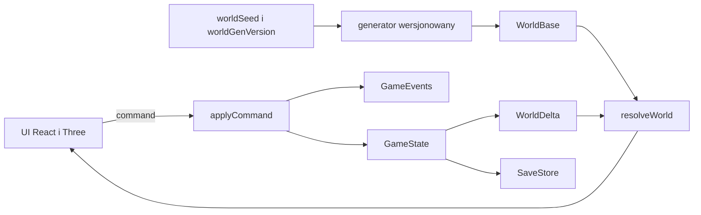

# Architektura

## Zasady

- Mapa miasta 2D (SVG), lokacje 3D (Three.js + React Three Fiber). Silnik gry nie zależy od Reacta ani Three.
- Jedno API zmian stanu: `applyCommand(state, command) -> { state, events }`. Komponenty wysyłają komendy i czytają stan. Zdarzenia są jedynym kanałem informowania o skutkach (UI, dźwięk, przyszła synchronizacja).
- Czysty silnik: bez `Math.random`, `Date.now`, `setTimeout` jako źródła prawdy; RNG i czas wstrzykiwane.
- Questy, przedmioty, surowce, receptury, zagadki, dialogi, ogłoszenia: dane w `content/`.
- Architektura gotowa na multiplayer: komendy i zdarzenia serializowalne, walidatory czyste, stan podzielony na `player` (per gracz) i `world` (wspólny). Multiplayer nie jest implementowany.

## Moduły (`src/lib/game/`)

- `core/`: `constants`, `clock`, `rng`, `ids`, `events`, `pause`, `state`, `apply` (dispatch komend).
- `content/`: dane (na razie przedmioty i domy; później questy, zagadki, receptury, regiony, odznaki).
- `systems/`: logika per domena (`session`, `vitals`, `inventory`, `houses`, `death`; później `quests`, `chests`, `harvest`, `troll`, `build`, `discovery`, `tutorial`).
- `world/`: (od W0) teren, generatory (wersjonowane), indeks przestrzenny, kolizje, walidator.
- `save/`: (od E1) schemat, migracje, `SaveStore`.
- `engine.ts`: fasada re-eksportująca publiczne API (zachowuje dotychczasowe importy).

UI w `src/components/game/` (mapa SVG, sklep, HUD, las). Logika questów nie trafia do komponentów lasu.

## Komendy i zdarzenia

`Command` (dawniej `Action`) to unia zserializowanych obiektów. `applyCommand` zwraca nowy stan i listę `GameEvent` (np. `item.purchased`, `player.died`, `time.pause_changed`). Reducer Reacta jest cienką nakładką: `reducer(state, cmd) = applyCommand(state, cmd).state`. Efekty uboczne UI (toast, dźwięk) są wyprowadzane ze zdarzeń; w E0 toast pozostaje w stanie (ze względu na zgodność), ale jego licznik jest częścią stanu (`toastSeq`), nie zmienną modułu.

## Centralna pauza czasu

Zegar gry jest zatrzymany, gdy istnieje choć jeden powód pauzy. Powody:

- systemowe (wyliczane ze stanu): `system.not_playing`, `system.dead`, `system.tutorial`,
- jawne (komendy): `pause.add { reason, owner }`, `pause.remove { reason, owner }`, `pause.clearOwner { owner }`.

Jawny powód to para `reason` + `owner` (np. `modal.dialog` + `npc.troll.bridge`). Dodanie jest idempotentne. Usunięcie jednego wpisu nie wznawia czasu, jeśli inny wpis lub powód systemowy nadal istnieje. `pause.clearOwner` służy do sprzątania przy zamykaniu widoku. Jawne pauzy nie są zapisywane (po wczytaniu gry lista jest pusta). `tick` nie zmienia `elapsed`, gdy `isTimePaused(state)`. Pauza dotyczy zegara, więc zatrzymuje też blokady liczone w `elapsed`.

## Postęp questów

Cele questów są wyliczane ze stanu gry (ekwipunek, flagi świata, ledger), nie z przycisków "ukończ". Cele typu "znaleziono" są monotoniczne (`ledger.obtained`), cele ilościowe liczą bieżące zasoby ze wszystkich dostępnych kontenerów gracza.

## Diagram

## Zmiany względem stanu sprzed etapu 1

Zachowujemy: czysty reducer, zegar, drenaż życia, sklep, domy i ich ulepszanie, 8 slotów (telefon usunięty z gry, SaveV3). Zmieniamy etapami: ID z przestrzeni nazw i stosy (E2), zapis i seed (E1), tutorial jako maszyna kroków (tutorial), skróty klawiszowe (UI1).
