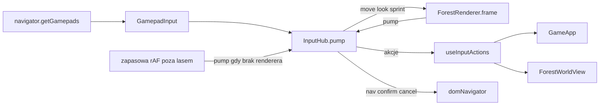

# Gamepad V1 (DualSense, Xbox i inne zgodne z Gamepad API)

Scenariusz testu: [test-reczny-gamepad-v1.md](test-reczny-gamepad-v1.md). Sterowanie klawiaturą: [sterowanie.md](sterowanie.md).

## Architektura (`src/lib/input/`)

| Plik | Rola |
| --- | --- |
| `actions.ts` | Akcje (`interact`, `confirm`, `cancel`, `inventory`, `journal`, `minimap`, `pause`, `nav*`, `slotPrev/Next`), źródła sygnału, typ urządzenia podpowiedzi. |
| `gamepadConfig.ts` | **Jedyne** miejsce z numerami przycisków i osi, tabela `BUTTON_BINDINGS` (akcja w grze / w interfejsie), progi, glify PS i Xbox. |
| `gamepadInput.ts` | Odczyt `navigator.getGamepads()` (wstrzykiwany): jeden aktywny pad, tylko `mapping === "standard"`, krawędzie naciśnięcia i zwolnienia, karencja 500 ms na brak danych, rozłączanie i powrót. Tablice prealokowane, brak alokacji własnych. |
| `analog.ts` | Radialny deadzone, krzywa reakcji (ruch `^1.35`, kamera `^1.7`), `mergeMove` (klawiatura ma pierwszeństwo, bez sumowania; zawieszenie zeruje oba źródła). |
| `inputHub.ts` | `pump(now)`: odczyt pada raz na klatkę, osie `move`/`look`/`sprint`, rozsyłanie akcji do handlerów (priorytety), repeater nawigacji (D-pad i lewy analog), `InteractGate` (jedno naciśnięcie = jedna interakcja także przy klawiaturze + padzie). |
| `deviceTracker.ts` | Aktywne urządzenie (klawiatura / PlayStation / Xbox) z histerezą: min. 0,4 s między przełączeniami, wychylenie > 0,5 przez 4 klatki, ruch myszy > 24 px. |
| `prompts.ts` | `hintLabel(akcja, urządzenie)`: etykiety z mapowania ([E] / [✕] / [A]); `padForestHelp`. |
| `uiNav.ts`, `domNavigator.ts` | Nawigacja przestrzenna po natywnym fokusie (czysta funkcja na prostokątach + cienka warstwa DOM), zatwierdzanie (klik), cofanie (syntetyczny Esc na dokumencie), ochrona 250 ms po otwarciu okna. |
| `controllerSettings.ts` | Ustawienia w `localStorage` (`miasto.input.gamepad`), poza `SaveV3`. |
| `haptics.ts` | Delikatne `dual-rumble` (skrzynia, przedmiot, most), tylko gdy włączone i obsługiwane. |
| `browser.ts` | Singleton huba, nasłuch zdarzeń DOM, zapasowa pętla poza lasem. |

React: `src/components/input/` (`hooks.ts`, `InputHint.tsx`, `PadKeyboard.tsx`), menu `PauseMenu.tsx` i `ControllerSettingsDialog.tsx` w `src/components/game/`.

## Przepływ

- **Jedna pętla.** W lesie hub jest pompowany z `ForestRenderer.frame` (renderer rejestruje się jako "kierowca"); odczyt nie dodaje własnego `requestAnimationFrame`. Poza lasem (miasto, sklep, ekrany) nie ma żadnej pętli, więc `browser.ts` uruchamia lekkie rAF **tylko gdy pad jest podłączony** i renderer nie pompuje; po opuszczeniu lasu pętla wraca automatycznie. Stan analogów nie trafia do Reacta (osie są w polach huba); React odświeża się tylko przy zmianie urządzenia, statusu pada i ustawień.
- **Tryb gry a tryb interfejsu.** `GameApp` ustawia `setFreeForest` (las, bez paneli i dialogu). Poza tym trybem albo gdy w DOM jest okno (`[data-slot="dialog-content"]`, `[data-gamepad-modal]`), przyciski dostają akcje interfejsu (✕ = zatwierdź, ○ = cofnij, D-pad = nawigacja); w wolnym lesie ✕ = interakcja, D-pad lewo/prawo = slot.
- **Wspólne akcje.** Klawiatura zostaje na własnych `keydown`, ale wywołuje te same funkcje co pad: `triggerInteract`, `requestMinimapToggle` (las), `togglePanel` (J, I, menu w `GameApp`). Brak osobnej logiki ruchu lub interakcji dla pada: pad wypełnia ten sam `MoveInput` (`mergeMove`) i woła `ForestInteractor.press()`.
- **Kamera.** `FirstPersonController.lookAnalog(x, y, dt, yawRate, pitchRate)`: prędkość w rad/s razy `dt` (obcięte do 0,1 s), ten sam limit pitch co mysz, bez wygładzania. Bez pointer lock; prawy analog jest ignorowany, gdy las jest zawieszony (`suspended`: okno, dialog, menu).
- **Ochrona przed podwójnym zatwierdzeniem.** Akcje tylko na krawędzi; 250 ms po pojawieniu się lub zniknięciu okna ✕ w interfejsie jest ignorowane; fokus początkowy okien o skutku "ryzykownym" ustawiony na bezpieczną opcję (`data-gamepad-initial`: troll "Może się dogadamy?", skrzynia "Zabierz", most "ZBUDUJ MOST" gdy gotowy, dom "Zamknij").
- **Klawiatura ekranowa** (`PadKeyboard`): cyfry w zagadce trolla, litery (z polskimi znakami) na ekranie imienia; widoczna tylko przy aktywnym padzie.

## Mapowanie

Patrz tabela w [test-reczny-gamepad-v1.md](test-reczny-gamepad-v1.md) i `BUTTON_BINDINGS`. Poza specyfikacją dodano: R1/R2 (oraz D-pad lewo/prawo w lesie) = poprzedni/następny slot; ✕ w lesie bez żadnej interakcji zjada zaznaczony przedmiot, jeśli leczy (jak E w pasku ekwipunku); menu gry otwiera OPTIONS lub przycisk "Menu" w górnym pasku.

## Ustawienia

`controllerSettings.ts`: czułość kamery (poziomo / pionowo, 0,25-3), deadzone lewego i prawego analoga (0,05-0,4, domyślnie 0,15), odwrócenie osi Y, wibracje. Dialog: menu gry -> "Ustawienia kontrolera" (przyciski +/-, natywny fokus).

## Znane ograniczenia

- Tylko standardowe mapowanie; niestandardowe jest ignorowane i zgłaszane w ustawieniach. Brak remappingu.
- Wibracje zależą od przeglądarki i połączenia; nic od nich nie zależy.
- Klawiatura nie jest w pełni przepięta przez hub (kompromis: brak ryzyka regresji w istniejących skrótach).
- Nawigacja przestrzenna opiera się na pozycjach elementów w DOM; nowe okna z elementami nieklikalnymi (bez `button`, `tabindex`, `role=button`) wymagają dodania fokusowalności.
- Dotyk i widok TPP: poza zakresem; `InputSource` i podział akcji są przygotowane na rozszerzenie.
- Agent nie uruchamiał testów, lint, typecheck, build ani przeglądarki; kod i testy jednostkowe są napisane, ale niezweryfikowane (patrz test ręczny).
